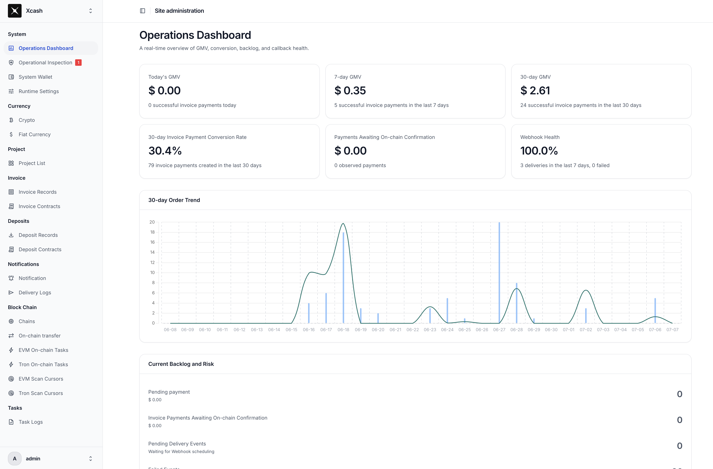

<div align="center">

**English** · [简体中文](README.md)

# Xcash

**Self-hosted, non-custodial crypto payment gateway**

Accept USDT, USDC, ETH and any ERC-20 across major EVM chains — plus USDT on Tron.
Funds move through smart contracts straight into your own wallet:
**zero platform fees, no KYC, no one standing between you and your money.**

<p>
  <a href="https://xca.sh"></a>
  <a href="https://xca.sh/docs/"></a>
  <a href="https://github.com/xca-sh/xcash/stargazers"></a>
  <a href="LICENSE"></a>
  
  
</p>

<p>
  <a href="#quick-start">Quick Start</a> ·
  <a href="https://xca.sh/docs/">Documentation</a> ·
  <a href="API.md">API Reference</a> ·
  <a href="https://xca.sh">Website</a>
</p>

<sub>E-commerce checkout · USDT deposits · Cross-border settlement · SaaS subscriptions · Wallets &amp; exchanges</sub>

</div>



## Why Xcash?

Hosted crypto payment processors take custody of your funds, charge a percentage of every transaction, require KYC, and can freeze your account. Xcash runs on your own server, and the money never stops being yours.

- **Non-custodial** — collections flow through smart contracts straight to your collection address. The system holds no business funds, and even a compromised server cannot change where the money goes.
- **Zero platform fees** — no percentage cut when you self-host. You only pay on-chain gas, and batched sweeping keeps it low.
- **Stablecoin-first, multi-chain** — any ERC-20 on Ethereum, BNB Chain, Arbitrum, Base, Polygon, Optimism and other EVM chains; USDT and TRX on Tron.
- **Two collection modes in one system** — invoice payments for checkout and subscriptions, plus exchange-style dedicated deposit addresses for platforms that maintain user balances.
- **Production-ready out of the box** — multi-merchant / multi-project isolation, optional MistTrack risk screening, reliable webhooks, HMAC-signed REST API, EasyPay V1 compatibility, one-command Docker deployment.

### How it compares

|  | **Xcash** (self-hosted) | Hosted processors¹ | BTCPay Server |
|---|:---:|:---:|:---:|
| Custody of funds | Non-custodial — straight to your wallet | Processor holds funds until payout | Non-custodial |
| Platform fee | **0** | typically 0.4%–1% per transaction | 0 |
| KYC / account approval | None | usually required | None |
| Stablecoins on EVM + Tron | Any ERC-20, plus Tron USDT | varies by provider | Bitcoin-first; altcoins via plugins |
| Exchange-style deposit addresses | Built-in | rare | — |
| EasyPay (易支付) V1 protocol | Compatible | — | — |

¹ e.g. CoinPayments, NOWPayments, CoinGate.

## Quick Start

Get a production gateway running in minutes. You need a Linux server with Docker and a domain pointed at it:

```bash
git clone https://github.com/xca-sh/xcash.git
cd xcash
./scripts/init_env.sh    # generates .env with random secrets
# edit .env and set SITE_DOMAIN=pay.example.com
docker compose up -d
```

The bundled Caddy listens on `127.0.0.1:6688`; point your reverse proxy (Nginx, Caddy, …) at it for TLS. First startup creates the admin account `admin` with a password randomly generated by `init_env.sh` — the script prints it once and stores it in `.env` as `DJANGO_DEFAULT_SUPERUSER_PASSWORD`, so **save it to your password manager**. Then, in the admin panel:

1. Fill in RPC endpoints for the chains you want to use (QuickNode / Alchemy / Infura; a TronGrid API key for Tron) and enable them.
2. Fund the system wallet with a small amount of gas on each enabled chain (Tron needs energy).
3. Create a project, set its receiving addresses, and integrate through the [REST API](API.md).

The [deployment guide](#deployment-guide) below covers every step; how it works and advanced configuration live at [xca.sh/docs](https://xca.sh/docs/).

> Don't want to run servers? **[xca.sh](https://xca.sh)** is the official hosted cloud — the first $500 of monthly volume is fee-free.

## Two ways to get paid

- **Invoice payments** — each transaction creates a fixed-amount, time-limited invoice that completes when the buyer pays. Ideal for e-commerce checkout and subscription billing. Supports both direct-to-wallet and smart-contract collection, and ships with a buyer-facing payment page in English and Chinese.
- **Deposits** — every user gets a dedicated deposit address. Users transfer in whenever they like and are credited after block confirmation, with no order to create. Ideal for wallets, trading platforms, and any business that maintains user balances.


## AML risk screening (optional)

Xcash can plug into [MistTrack](https://misttrack.io/) address risk scores (via QuickNode's MistTrack Address Risk Scores add-on) to run anti-money-laundering checks on the **payer address** of each payment:

- **Per-project switch** — each project decides whether screening is on and sets its own *AML Query Threshold* (default 100 USD); only invoices and deposits worth more than the threshold are queried, keeping lookup costs under control.
- **Runs alongside confirmation** — the lookup starts as soon as a transfer is matched to an invoice or deposit, so it never slows confirmation down; the result is pushed in the webhook as `risk_level` (`Low` / `Moderate` / `High` / `Severe`) and `risk_score`, and invoices and deposits can be filtered by risk level in the admin panel.
- **Live lookup for every payment** — address verdicts are never cached, so an attacker cannot "clean" an address with legitimate funds first and then pay with tainted ones.
- **Scores, never blocks** — funds go straight to the merchant's wallet through the contract, so the system cannot and does not refuse them. The risk result never changes confirmation, sweeping or notifications; **the merchant decides, based on the risk level and score, whether to ship, credit, freeze or refund**.

Payments that do not qualify (screening off, at or below the threshold, small invoices settled by fast confirmation, unsupported chains such as testnets, or failed lookups) have `null` risk fields — `null` does not mean low risk. See [API.md · AML 风控](API.md#aml-风控) for how to enable it and what each field means.

## Works with your existing stack

- **WooCommerce** — the official **Xcash for WooCommerce** plugin adds USDT, USDC and other crypto checkout to a WordPress store in a few steps. [Download](https://xca.sh/#integration)
- **EasyPay (易支付) ecosystem** — any system that speaks the standard EasyPay V1 protocol plugs in without code changes: Xboard, V2board, New API, 独角数卡, 异次元发卡 (WHMCS in progress).
- **Everything else** — create invoices and hand out deposit addresses through the [REST API](API.md); webhooks push payment events in real time.

## Chain and token support

| Feature | ETH | BNB Chain | Arbitrum | Base | Tron | Polygon | Optimism |
|:--:|:---:|:---------:|:--------:|:----:|:----:|:-------:|:--------:|
| Payments | Yes | Yes | Yes | Yes | Yes | Yes | Yes |
| Deposits | Yes | Yes | Yes | Yes | Yes | Yes | Yes |

- **EVM** — USDT, USDC and other common stablecoins are preloaded; add any other ERC-20 token's contract address under **Currency → Crypto** in the admin panel.
- **Tron** — USDT and native TRX.

The mainnets above plus the Sepolia and Nile testnets are preloaded; Avalanche, Linea and Scroll must be added manually in the admin panel; any other chain requires code changes.

## Deployment guide

### Prerequisites

- Linux server, Ubuntu 22.04+ or Debian 12+ recommended
- Docker and Docker Compose
- A domain resolved to the server IP
- RPC endpoints for the chains you want to enable; a TronGrid API key for Tron

Recommended server profiles (set `PERFORMANCE` in `.env`, default `low`):

| Performance mode | Hardware | EVM chain capacity | Django processes |
|:-------:|:-------:|:-----------:|:----------------:|
| low | 1 CPU / 2 GB | 2 – 3 EVM chains | 1 |
| medium | 4 CPU / 8 GB | 8 – 15 EVM chains | 2 |
| high | 8 CPU / 16 GB | 15 – 30 EVM chains | 4 |

Production Gunicorn uses a fixed 4 request threads per Django process, providing 4 / 8 / 16 concurrent Web request slots across the profiles.
`PERFORMANCE` only controls the Django process count, which can be overridden with `GUNICORN_WORKERS`; the thread count is no longer configurable.
Business task concurrency defaults to 16 independently of the profile. Override it with `WORKER_CONCURRENCY` in both production and development.
These are deployment guidelines; actual capacity depends on RPC response times, request load, and database resources.

### 1. Get the code and generate the config

```bash
git clone https://github.com/xca-sh/xcash.git
cd xcash
./scripts/init_env.sh
```

The script generates `.env` with random secrets and a database password; it refuses to overwrite an existing `.env`.

### 2. Set the domain and reverse proxy

Edit `.env` to set the domain, and make sure its DNS resolves to the server:

```env
SITE_DOMAIN=xcash.example.com
```

Forward traffic to `http://127.0.0.1:6688` with Nginx or Caddy. **Your reverse proxy must forward the real client IP and request protocol**, otherwise merchant IP allowlists and rate limits stop working.

**Nginx:**

```nginx
location / {
    proxy_pass http://127.0.0.1:6688;
    proxy_set_header Host $host;
    proxy_set_header X-Real-IP $remote_addr;
    proxy_set_header X-Forwarded-Proto $scheme;
}
```

**Caddy** (forwards the required headers automatically):

```caddyfile
xcash.example.com {
    reverse_proxy 127.0.0.1:6688
}
```

Setting `ADMIN_PATH` to move the admin panel to a custom path is recommended (it sits at the site root when unset):

```env
ADMIN_PATH=secure-admin
```

### 3. Start the services

```bash
docker compose up -d
```

The image is pulled from `ghcr.io/xca-sh/xcash` and database migrations run automatically at startup. First startup creates the admin account `admin` with the password from `DJANGO_DEFAULT_SUPERUSER_PASSWORD` in `.env`; in production, an empty password, one shorter than 12 characters, or the placeholder value makes it refuse to create the admin and abort startup.

### 4. Configure and enable chains

Log in to the admin panel and go to **Block Chain → Chains**: fill in an RPC endpoint for each EVM chain (recommended: [QuickNode](https://www.quicknode.com/), [Alchemy](https://www.alchemy.com/) or [Infura](https://www.infura.io/)) and a [TronGrid](https://www.trongrid.io/) API key for Tron, then tick *Enabled*.

### 5. Fund the system wallet

Go to **System → System Wallet** and copy the system wallet address:

- **EVM chains** — send a small amount of the native asset (ETH, BNB, POL, …) for gas.
- **Tron** — provide energy (for example by staking TRX) and keep a small TRX balance for bandwidth.

The system wallet only pays for system operations such as contract deployment and sweeps; do not park business funds in it.

### 6. Configure a project

Go to **Project → Project List** and create a project; each one has its own `App ID` and `HMAC key`. Then configure:

- **IP whitelist** — merchant server IPs allowed to call the API; `*` is fine while testing, narrow it in production.
- **Notification URL** — receives webhook events.
- **Receiving addresses** — invoices use direct-to-wallet collection by default, so adding your own *Direct Wallet Address* on the project page is enough; deposits and smart-contract invoices need a *collection address* for the matching chain type (EVM / Tron), which **cannot be changed once set** — a multisig wallet is recommended.

The project is ready only once all of the above is in place; otherwise the API returns `1004`. Then follow the [API documentation](https://xca.sh/docs/#api-base) or [API.md](API.md) to integrate payments, deposits and webhooks.

To use [AML risk screening](#aml-risk-screening-optional), first enter a QuickNode endpoint with the MistTrack Address Risk Scores add-on under **System → Runtime Settings → AML Screening**, then enable it and set the query threshold on the *AML Screening* tab of the project page.

## Backup and restore

The key that encrypts wallet mnemonics lives in `.env` as `WALLET_MNEMONIC_ENCRYPTION_KEY`, not in the database. **The database and `.env` must be backed up together** — neither one alone can restore a wallet.

Back up the database (at least daily, encrypted together with `.env` and stored off this server):

```bash
docker compose exec -T db sh -c 'pg_dump --format=custom --no-owner --no-privileges -U "$POSTGRES_USER" -d "$POSTGRES_DB"' > xcash-$(date +%Y%m%d-%H%M%S).dump
```

Restore:

```bash
# 1. Stop application services, keep the database running
docker compose stop django worker chain-runner

# 2. Put .env back in place (it must be the copy matching this dump)

# 3. Load the dump (the target database must be empty)
docker compose exec -T db sh -c 'pg_restore --exit-on-error --no-owner --no-privileges -U "$POSTGRES_USER" -d "$POSTGRES_DB"' < xcash-YYYYmmdd-HHMMSS.dump

# 4. Bring the services back up
docker compose up -d
```

## Operations

```bash
docker compose ps        # show service status
docker compose down      # stop services (database volumes are kept)
```

Upgrade to the latest version (make sure you are on `main`):

```bash
git pull && ./scripts/upgrade.sh
```

The script pulls the new image, runs migrations and restarts the services, reporting success only once everything is ready; on failure it exits nonzero and prints troubleshooting hints.

Always upgrade with this script instead of a manual `docker compose up -d`: it stops the old processes in order, migrates in-flight tasks the previous version left in Redis, and removes retired services with `--remove-orphans`. When upgrading from a Celery-based version in particular, a manual `up -d` leaves the old beat running as an orphan container that keeps publishing tasks nobody consumes until Redis hits its memory limit.

## Tech stack

- **Backend**: Django 5.2 + Django REST Framework
- **Task queue**: Procrastinate (PostgreSQL task queue)
- **Database**: PostgreSQL
- **Blockchain interaction**: web3.py (EVM), TronGrid HTTP API (Tron)
- **Wallet derivation**: BIP44 HD wallets (bip-utils)
- **Payment page**: React 19 + Vite + Tailwind CSS
- **Deployment**: Docker Compose

## Roadmap

- [x] Tron support
- [ ] Solana support
- [x] Documentation site improvements

## Hosted cloud

If you'd rather not deploy and maintain Xcash yourself, use the official hosted version at **[xca.sh](https://xca.sh)** — no deployment, no maintenance, continuously updated.

Fees are tiered on monthly volume and charged per tier: **the first $500 every month is free**, then 1% → 0.8% → 0.6% → 0.4% as volume grows. Self-hosting stays free and fee-free either way.

## Support

- **Bugs & questions**: [open an issue](https://github.com/xca-sh/xcash/issues)
- **Commercial support**: tech@xca.sh

## Contributing

Issues and pull requests are welcome — see [CONTRIBUTING.md](CONTRIBUTING.md).

If Xcash saves you money, consider giving it a ⭐ — it helps other merchants find the project.

## License

[MIT](LICENSE)
