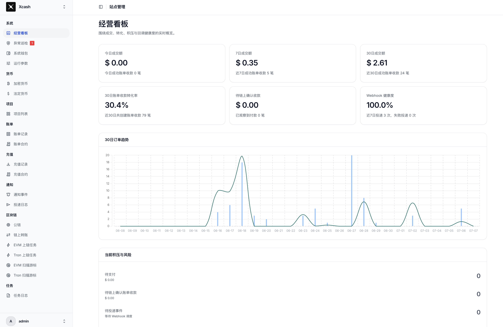

<div align="center">

[English](README.en.md) · **简体中文**

# Xcash

**开源 · 自部署 · 非托管加密货币支付网关**

支持主流 EVM 链上任意 ERC-20 代币与 Tron USDT 收款，
资金经智能合约直达你自己的钱包：**零平台手续费、免 KYC、全程不托管。**

<p>
  <a href="https://xca.sh"></a>
  <a href="https://xca.sh/docs/"></a>
  <a href="https://github.com/xca-sh/xcash/stargazers"></a>
  <a href="LICENSE"></a>
  
  
</p>

<p>
  <a href="#快速开始">快速开始</a> ·
  <a href="https://xca.sh/docs/">官方文档</a> ·
  <a href="API.md">API 参考</a> ·
  <a href="https://xca.sh">官网</a>
</p>

<sub>电商账单 · USDT 充值 · 跨境结算 · SaaS 订阅 · 钱包 / 交易所</sub>

</div>



## 为什么选 Xcash？

托管式收款处理商会先代收你的资金、按笔抽成、要求 KYC，还可能冻结账户。Xcash 跑在你自己的服务器上，钱从头到尾都是你的。

- **非托管** —— 收款经智能合约直达你的归集地址，系统不托管业务资金，即便服务器被攻破也改不了资金流向。
- **零平台手续费** —— 自部署不按交易抽成，只承担链上 Gas，批量归集进一步压低开销。
- **稳定币优先、多链覆盖** —— Ethereum、BNB Chain、Arbitrum、Base、Polygon、Optimism 等 EVM 链上任意 ERC-20；Tron 支持 USDT 与 TRX。
- **一套系统、两种收款** —— 账单收款覆盖电商下单、订阅计费；充值收款提供交易所式专属地址，适合维护用户余额的平台。
- **生产级配套开箱即用** —— 多商户多项目隔离、MistTrack 链上风控（可选）、可靠 Webhook、HMAC 签名 REST API、易支付 V1 兼容、Docker 一键部署。

### 与常见方案对比

|  | **Xcash**（自部署） | 托管处理商¹ | BTCPay Server |
|---|:---:|:---:|:---:|
| 资金托管 | 非托管，直达你的钱包 | 处理商代收，结算后放款 | 非托管 |
| 平台手续费 | **0** | 通常按笔抽 0.4%–1% | 0 |
| KYC / 开户审核 | 无 | 通常需要 | 无 |
| EVM + Tron 稳定币 | 任意 ERC-20 + Tron USDT | 视服务商而定 | 以 BTC 为主，其他币靠插件 |
| 交易所式充值地址 | 内置 | 少见 | — |
| 易支付 V1 协议 | 兼容 | — | — |

¹ 如 CoinPayments、NOWPayments、CoinGate 等。

## 快速开始

几分钟内启动一套生产网关。你需要一台装有 Docker 的 Linux 服务器和一个已解析到它的域名：

```bash
git clone https://github.com/xca-sh/xcash.git
cd xcash
./scripts/init_env.sh    # 生成 .env 并自动填充随机密钥
# 编辑 .env，设置 SITE_DOMAIN=pay.example.com
docker compose up -d
```

内置 Caddy 监听 `127.0.0.1:6688`，用你的反向代理（Nginx、Caddy 等）转发流量并配置 TLS。首次启动会创建后台账号 `admin`，其密码由 `init_env.sh` 随机生成——脚本执行完会打印一次，同时保存在 `.env` 的 `DJANGO_DEFAULT_SUPERUSER_PASSWORD`，**请存入密码管理器**。然后在管理后台完成三步：

1. 为需要使用的公链填写 RPC 节点（QuickNode / Alchemy / Infura；Tron 填写 TronGrid API Key）并启用。
2. 为系统钱包在每条启用的链上充值少量 Gas（Tron 需准备能量）。
3. 创建项目、设置收款地址，通过 [REST API](API.md) 完成对接。

完整步骤见下方[部署指南](#部署指南)，原理与进阶配置见[官方文档](https://xca.sh/docs/)。

> 不想自己运维？**[xca.sh](https://xca.sh)** 提供官方云服务——每月首 $500 交易额免手续费。

## 两种收款方式

- **账单收款**：每笔交易创建一张定额、限时的账单，买家付款后完成，适合电商下单、订阅计费。支持钱包直收与智能合约收款两种模式，自带中英双语买家支付页。
- **充值收款**：为每个用户分配专属充值地址，用户随时转入、区块确认后入账，无需创建订单，适合钱包、交易类等需要维护用户余额的业务。


## AML 链上风控（可选）

Xcash 可接入 [MistTrack](https://misttrack.io/) 地址风险评分（通过 QuickNode 的 MistTrack Address Risk Scores add-on），对收款的**付款地址**做反洗钱筛查：

- **按项目开关**：每个项目独立设置是否开启、以及「AML 查询阈值」（默认 100 USD），只有价值高于阈值的账单与充值才查询，控制查询成本。
- **与确认并行**：转账一匹配到账单/充值就开始查询，不拖慢确认；结果随 Webhook 的 `risk_level`（`Low` / `Moderate` / `High` / `Severe`）和 `risk_score` 推送，也可在后台账单、充值列表中按风险等级筛选。
- **每笔实时查询**：不缓存地址结论，防止先用干净资金"洗白"地址再付黑币。
- **只评分、不拦截**：资金经合约直达商户钱包，系统无法也不会拒收。风险结果不改变确认、归集与通知流程，**是否发货、上账、冻结或退款由商户根据风险等级和分数自行判断**。

未满足条件（未开启、低于阈值、走快速确认的小额账单、测试网等不支持的链、查询失败）的收款，风险字段为 `null`，`null` 不代表低风险。开启方法与字段细节见 [API.md · AML 风控](API.md#aml-风控)。

## 接入你现有的技术栈

- **WooCommerce** —— 官方 **Xcash for WooCommerce** 插件，几步为你的 WordPress 商店加上 USDT、USDC 等加密货币结账。[下载插件](https://xca.sh/#integration)
- **易支付生态** —— 支持标准易支付 V1 协议的系统无需改造即可接入：Xboard、V2board、New API、独角数卡、异次元发卡（WHMCS 开发中）。
- **其他系统** —— 通过 [REST API](API.md) 创建账单、分配充值地址，Webhook 实时推送收款事件。

## 链与代币支持

| 功能 | ETH | BNB Chain | Arbitrum | Base | Tron | Polygon | Optimism |
|:--:|:---:|:---------:|:--------:|:----:|:----:|:-------:|:--------:|
| 账单收款 | 是 | 是 | 是 | 是 | 是 | 是 | 是 |
| 充值收款 | 是 | 是 | 是 | 是 | 是 | 是 | 是 |

- **EVM**：已预置 USDT、USDC 等常用稳定币，其他 ERC-20 代币可在后台 **货币 → 加密货币** 中添加合约地址。
- **Tron**：支持 USDT 与原生 TRX。

上表主网与测试网 Sepolia、Nile 默认预置；Avalanche、Linea、Scroll 需在后台手动添加；其他链需要改代码接入。

## 部署指南

### 部署前准备

- Linux 服务器，推荐 Ubuntu 22.04+ 或 Debian 12+
- Docker 和 Docker Compose
- 已解析到服务器 IP 的域名
- 需要启用的公链 RPC 节点；启用 Tron 需要 TronGrid API Key

推荐服务器配置（在 `.env` 中设置 `PERFORMANCE`，默认 `low`）：

| 性能模式 | 硬件配置 | 可承载链数量 |
|:-------:|:-------:|:-----------:|
| low | 1 核 / 2 GB | 2 - 3 条 EVM 链 |
| medium | 4 核 / 8 GB | 8 - 15 条 EVM 链 |
| high | 8 核 / 16 GB | 15 - 30 条 EVM 链 |

### 1. 获取代码并生成配置

```bash
git clone https://github.com/xca-sh/xcash.git
cd xcash
./scripts/init_env.sh
```

脚本会生成 `.env` 并填充随机密钥与数据库口令；`.env` 已存在时会拒绝覆盖。

### 2. 设置域名与反向代理

编辑 `.env` 设置域名，并确保 DNS 已解析到服务器：

```env
SITE_DOMAIN=xcash.example.com
```

用 Nginx 或 Caddy 将流量转发至 `http://127.0.0.1:6688`。**反向代理必须转发真实客户端 IP 与请求协议**，否则商户 IP 白名单与限流都会失效。

**Nginx 示例：**

```nginx
location / {
    proxy_pass http://127.0.0.1:6688;
    proxy_set_header Host $host;
    proxy_set_header X-Real-IP $remote_addr;
    proxy_set_header X-Forwarded-Proto $scheme;
}
```

**Caddy 示例**（自动转发所需请求头）：

```caddyfile
xcash.example.com {
    reverse_proxy 127.0.0.1:6688
}
```

建议设置 `ADMIN_PATH` 把后台移到自定义路径（未设置时挂在站点根路径）：

```env
ADMIN_PATH=secure-admin
```

### 3. 启动服务

```bash
docker compose up -d
```

镜像自动从 `ghcr.io/xca-sh/xcash` 拉取，启动时会自动执行数据库迁移。首次启动会创建后台账号 `admin`，密码为 `.env` 中的 `DJANGO_DEFAULT_SUPERUSER_PASSWORD`；生产环境下该口令为空、短于 12 位或等于示例值时会拒绝创建管理员并中止启动。

### 4. 配置并启用公链

登录管理后台，进入 **区块链 → 公链**：EVM 链填写 RPC 地址（推荐 [QuickNode](https://www.quicknode.com/)、[Alchemy](https://www.alchemy.com/) 或 [Infura](https://www.infura.io/)），Tron 填写 [TronGrid](https://www.trongrid.io/) API Key，然后勾选「启用」。

### 5. 为系统钱包准备 Gas

进入 **系统 → 系统钱包**，复制系统钱包地址：

- **EVM 链**：充值少量原生资产（ETH、BNB、POL 等）支付 Gas。
- **Tron**：准备能量（如质押 TRX），并保留少量 TRX 支付带宽。

系统钱包只用于合约部署、归集等系统操作，无需存入业务资金。

### 6. 配置项目

进入 **项目 → 项目列表** 创建项目，每个项目有独立的 `Appid` 和 `HMAC密钥`。然后配置：

- **IP 白名单**：允许调用 API 的服务器 IP；测试阶段可用 `*`，生产环境建议收窄。
- **通知地址**：接收 Webhook 事件。
- **收款地址**：账单默认使用钱包直收，在项目页添加你自己的「钱包直收地址」即可；若要使用充值收款或智能合约账单收款，需配置对应链类型（EVM / Tron）的「归集地址」，**一旦设置不可修改**，建议使用多签钱包。

以上配置齐全后项目才就绪，否则 API 返回 `1004`。

如需 [AML 链上风控](#aml-链上风控可选)：先在 **系统 → 运行参数 → AML 筛查** 填写开通了 MistTrack Address Risk Scores add-on 的 QuickNode endpoint，再在项目详情页的「AML 筛查」标签开启并设置查询阈值。之后参考 [API 对接文档](https://xca.sh/docs/#api-base) 或 [API.md](API.md) 接入账单收款、充值收款和 Webhook。

## 备份与恢复

助记词的加密密钥保存在 `.env` 的 `WALLET_MNEMONIC_ENCRYPTION_KEY`，不在数据库里。**数据库与 `.env` 必须成对备份**，缺任何一份都无法恢复钱包。

备份数据库（建议每天一次，并与 `.env` 一起加密存到服务器之外）：

```bash
docker compose exec -T db sh -c 'pg_dump --format=custom --no-owner --no-privileges -U "$POSTGRES_USER" -d "$POSTGRES_DB"' > xcash-$(date +%Y%m%d-%H%M%S).dump
```

恢复：

```bash
# 1. 停止业务服务，保留数据库
docker compose stop django worker chain-runner beat

# 2. 把 .env 恢复到位（务必是与该 dump 同时点的那一份）

# 3. 灌入 dump（目标库需为空库）
docker compose exec -T db sh -c 'pg_restore --exit-on-error --no-owner --no-privileges -U "$POSTGRES_USER" -d "$POSTGRES_DB"' < xcash-YYYYmmdd-HHMMSS.dump

# 4. 拉起服务
docker compose up -d
```

## 运维命令

```bash
docker compose ps        # 查看服务状态
docker compose down      # 停止服务（保留数据库数据卷）
```

升级到最新版（确认位于 `main` 分支）：

```bash
git pull && ./scripts/upgrade.sh
```

脚本会拉取新镜像、执行迁移并平滑重启，全部就绪才报告成功；失败时会返回非零状态并输出排查提示。

## 技术栈

- **后端**：Django 5.2 + Django REST Framework
- **任务队列**：Celery + Redis
- **数据库**：PostgreSQL
- **区块链交互**：web3.py（EVM）、TronGrid HTTP API（Tron）
- **钱包派生**：BIP44 HD 钱包（bip-utils）
- **前端账单收款页**：React 19 + Vite + Tailwind CSS
- **部署**：Docker Compose

## 路线图

- [x] Tron 链支持
- [ ] Solana 链支持
- [x] 完善文档站

## 官方云服务

如果你不想自己部署和维护，可以直接使用官方托管版本：**[xca.sh](https://xca.sh)** —— 开箱即用、免部署、免运维、持续更新。

云服务按月交易额分段计费，每段只按本段费率收取：**每月首 $500 免手续费**，之后随交易量 1% → 0.8% → 0.6% → 0.4% 递减。自部署始终免费、零平台手续费。

## 支持

- **Bug 与使用问题**：[提交 Issue](https://github.com/xca-sh/xcash/issues)
- **商业技术支持**：tech@xca.sh

## 贡献

欢迎提交 Issue 和 Pull Request，参与方式见 [CONTRIBUTING.md](CONTRIBUTING.md)。

如果 Xcash 帮你省了钱，欢迎点一个 ⭐——这能让更多商户发现这个项目。

## License

[MIT](LICENSE)
